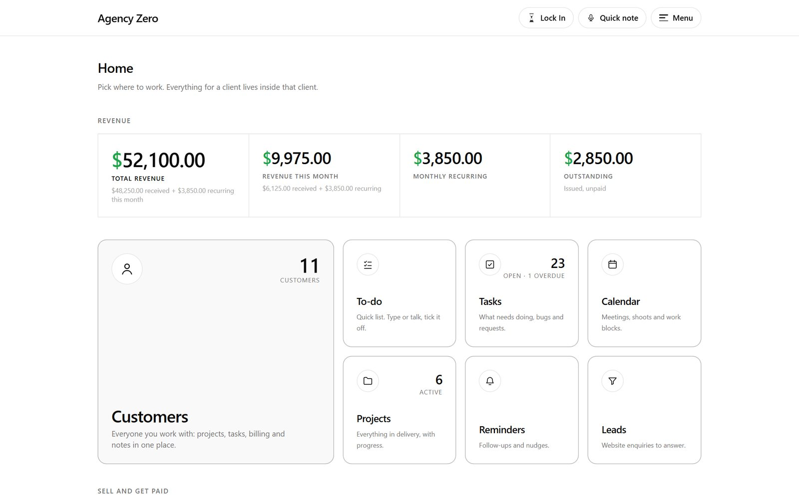
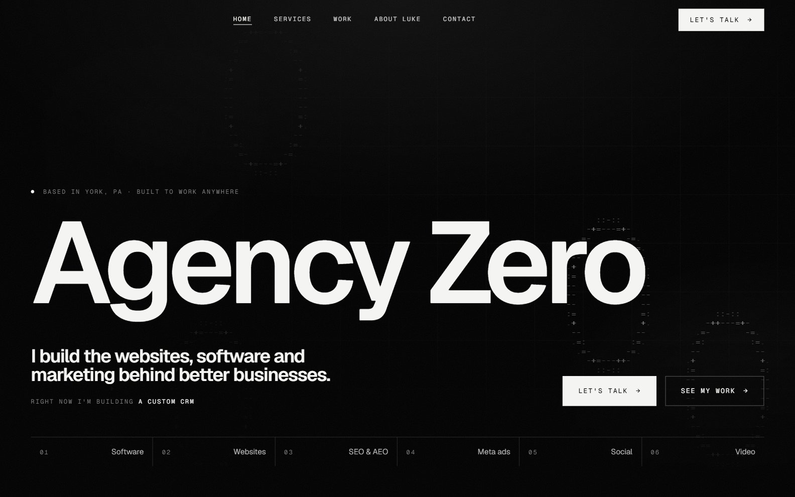
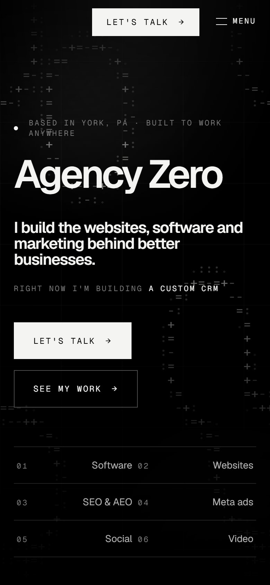
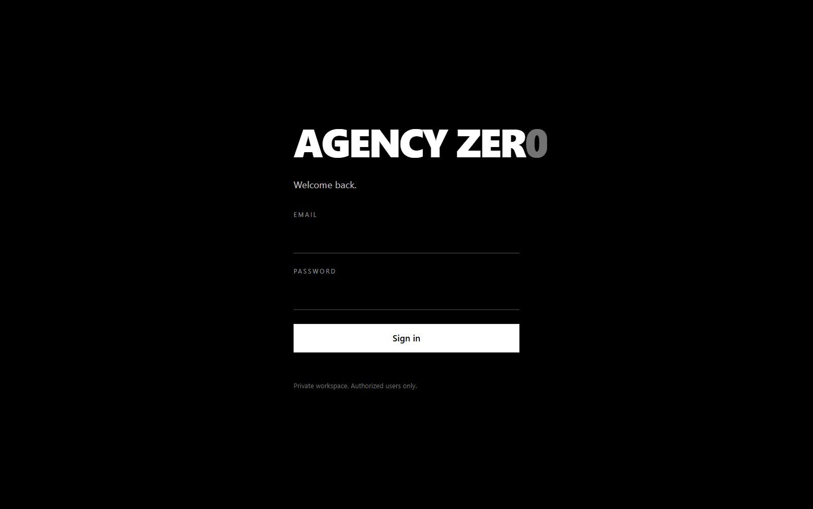
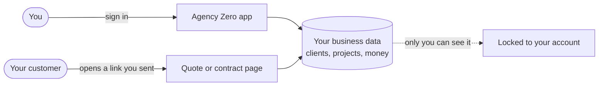
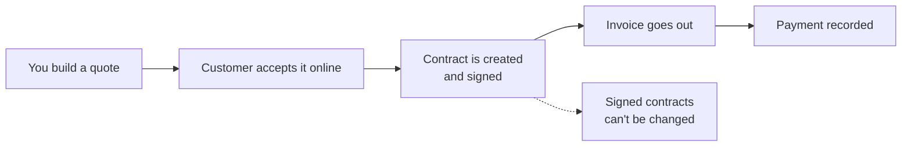
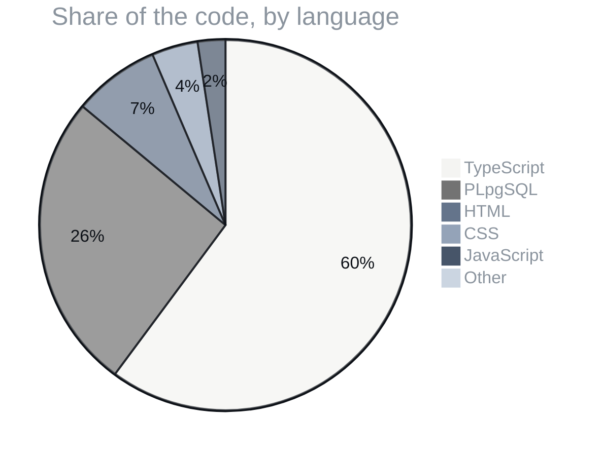

<p align="center">
  
</p>

<p align="center">
  
  
  
  
</p>
<p align="center">
  
  
  
  
  
  
  
  
</p>

<h3 align="center">One app to run the whole agency: clients, projects, quotes, contracts, invoices, workload and the calendar.</h3>

<p align="center">
  <a href="#01--what-it-does">What it does</a> ·
  <a href="#02--inside-the-app">Inside the app</a> ·
  <a href="#03--how-it-works">How it works</a> ·
  <a href="#04--from-quote-to-paid">From quote to paid</a> ·
  <a href="#05--what-its-written-in">What it's written in</a> ·
  <a href="#field-manual">Field manual</a> ·
  <a href="#license">License</a>
</p>

<p align="center"></p>


> [!TIP]
> **🤖 Pasted this link into Claude or ChatGPT?** AI assistants: read [`docs/AI_GUIDE.md`](https://raw.githubusercontent.com/F0rger123/Agency-Zero/main/docs/AI_GUIDE.md) first. It explains what this is in plain words, which questions to ask, and how to set it up step by step. Plain-text index: [`llms.txt`](https://raw.githubusercontent.com/F0rger123/Agency-Zero/main/llms.txt).

## 01 · What it does

Agency Zero is a private CRM and operating system for a solo operator selling software, websites, SEO, Meta ads, social media management and video. Black, white and grayscale only. Emphasis comes from weight, size and contrast, never hue, with one exception: money is green, so currency reads at a glance.

| Module | What you get |
|---|---|
| **Clients & projects** | Client records, projects, tasks, notes and a full activity trail |
| **Quotes** | Packages and options, customer selection, public acceptance links with frozen snapshots |
| **Contracts** | Templates, placeholders, versioning, signing, immutable once signed |
| **Invoices & payments** | Invoices, manual payments, revenue tracking, profitability view |
| **Calendar & workload** | Day, week and month views, capacity planning, overload detection, rescheduling |
| **Lock In & Quick note** | Focus timer and voice-dictated notes from the top bar |
| **Security** | Row-level security on every table, passkeys (WebAuthn), narrow RPCs for public links |

## 02 · Inside the app

<table>
  <tr>
    <td colspan="2"><br><sub><b>CRM home.</b> Revenue, recurring income, outstanding invoices and every module one click away. Shown with demo data.</sub></td>
  </tr>
  <tr>
    <td width="72%"><br><sub><b>Public site.</b> The marketing half lives in the same app at <code>/</code>.</sub></td>
    <td width="28%"><br><sub><b>Mobile.</b></sub></td>
  </tr>
  <tr>
    <td colspan="2"><br><sub><b>Sign in.</b> There is no public sign-up. The owner account is created in Supabase.</sub></td>
  </tr>
</table>

## 03 · How it works



## 04 · From quote to paid



## 05 · What it's written in



<p align="center"></p>

## Field manual

A private, lightweight agency CRM / operating system — built for a solo operator running an agency that sells:

**software development · custom CRMs & software · websites · SEO · Meta ads · social media management · social video creation**

Agency Zero manages the full lifecycle in one place: clients, projects, tasks, workload planning, a calendar, quotes → contracts → invoices → payments, social media and marketing delivery (Meta Ads, SEO), an AI assistant, reminders, a profitability view, and eventually a client-facing portal.

## Status

🚧 **Phases 4–5 + production hardening pass — Sales, scheduling, workload & reminders (code complete; pending live Supabase verification).**
The app now includes the CRM core plus quotes with packages/options and customer selection, secure public quote acceptance with frozen snapshots, contract templates/placeholders/versioning/signing, immutable accepted-quote and signed-contract protection, invoices, manual payments, revenue tracking, daily/weekly/monthly calendar views, capacity planning, overload detection, task rescheduling, and live/custom reminders. All internal tables use row-level security, tokenized public surfaces use narrow RPCs, and no mock data or Stripe/Google Calendar integrations are used.

**Remaining before the built phases are fully verified:** provision a Supabase project, apply `supabase/migrations/0001` through `0008` and `0010` through `0013` (`0009` is production-only, see `supabase/README.md`), create the owner user, and exercise the owner/customer sales and planning flows (see `supabase/README.md`).

## Tech stack

- **Next.js** (App Router) + **TypeScript**
- **Tailwind CSS** v4 — black / white / grayscale only; no gradients, no accent colors
- **Supabase** — Postgres, Auth, Storage
- Stripe, Google Calendar, Meta, Search Console, and GA4 integrations are **deferred by design**; the architecture is prepared for them (adapter boundaries + integration-ready schema)

## Getting started

```bash
npm install
cp .env.example .env.local   # fill in all three variables
```

1. Create a Supabase project, configure Auth URLs, and apply migrations
   `0001` through `0008` and `0010` through `0013` in order — full instructions are in
   [`supabase/README.md`](supabase/README.md).
2. Create the owner account in Supabase (Authentication → Users → Add user) —
   there is **no sign-up page by design**.
3. `npm run dev` and sign in at `/login`.

For the Cloudflare Workers live-test setup, including exact build/runtime
variables and OpenNext configuration, read
[`docs/DEPLOYMENT.md`](docs/DEPLOYMENT.md).

### Scripts

| Command | Purpose |
|---|---|
| `npm run dev` | Development server |
| `npm run build` | Production build (runs type checking) |
| `npm run start` | Serve the production build |
| `npm run lint` | ESLint |
| `npx tsc --noEmit` | Type check |
| `npm run cf-typegen` | Generate Wrangler binding types |
| `npm run preview` | Build with OpenNext and run the local Workers runtime |
| `npm run deploy` | Build and deploy to Cloudflare (run only after setup) |

## Project structure

```
docs/            Requirements, decisions, roadmap, database plan (read these first)
supabase/        SQL migrations, CLI config + setup guide
src/app/         Routes: (app)/ dashboard + sections, login/, auth/callback
src/components/  App shell, icons, shared states
src/lib/         Supabase clients (server/browser/config), navigation
src/proxy.ts     Next.js 16 proxy (auth session + route protection)
open-next.config.ts / wrangler.jsonc  Cloudflare OpenNext Worker configuration
```

## Routes

`/` public marketing site · `/app/**` protected CRM (owner / authorised team) · `/login` · `/q/<token>` and `/c/<token>`
customer links. See `docs/DEPLOYMENT.md` ("Public site + CRM on one domain").

## Documentation

Agents: start with [`AGENTS.md`](AGENTS.md) (session protocol) and [`docs/development/`](docs/development/) (VISION, ROADMAP, ACTIVE, BUGS, IDEAS, HANDOFF, AUDIT). The docs in [`/docs`](docs/) are the permanent record:

| Document | Purpose |
|---|---|
| [`docs/MASTER_SPEC.md`](docs/MASTER_SPEC.md) | **Source of truth.** All requirements. Never remove a requirement unless the owner explicitly says so; new ideas are merged into existing sections. |
| [`docs/DECISIONS.md`](docs/DECISIONS.md) | Decision log — what was decided, when, and why. |
| [`docs/development/IDEAS.md`](docs/development/IDEAS.md) | Future / incomplete ideas, waiting to be confirmed. |
| [`docs/BUILD_PROGRESS.md`](docs/BUILD_PROGRESS.md) | Phased roadmap and current build status. |
| [`docs/DATABASE_PLAN.md`](docs/DATABASE_PLAN.md) | Database entity plan + migration log. |

## Ground rules for agents working on this repo

1. `docs/MASTER_SPEC.md` is the single source of truth and is additive-only.
2. Build in phases — do not attempt every integration at once.
3. The AI assistant never silently performs high-impact financial or ad-spend actions; it recommends, the owner approves.
4. No fake UI: unbuilt features get honest "planned" states, never dead buttons that pretend to work.

## License

Released under the [MIT License](LICENSE). Use it, fork it, ship it.

<p align="center"></p>

<p align="center">
  <sub>Built by <a href="https://github.com/F0rger123"><b>@F0rger123</b></a> · MIT licensed</sub>
</p>
